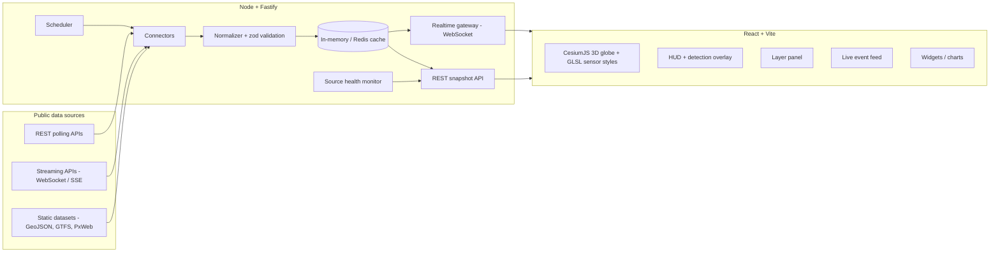

# Gothenburg OSINT Dashboard – Plan

An open-source research tool: a live-updating 3D dashboard that combines open data about Gothenburg (Göteborg) and related live feeds on one map of the city. Everyone runs their own copy locally; there is no hosted site.

## 1. Decisions so far

| Topic | Decision |
| --- | --- |
| Stack | TypeScript end to end: React + Vite (web), Node + Fastify (server) |
| Visual direction | Inspired by [God's Eye View](https://github.com/bilawalsidhu/gods-eye-view): 3D city, ops-room HUD, sensor-style shaders, click-to-track |
| Map engine | CesiumJS 3D globe (replaces MapLibre + deck.gl) |
| Audience | Research tool. Public GitHub repo (MIT); each user runs it locally (`npm start` or `docker compose up`) with their own optional keys. No hosted site or domain. |
| Data retention | Live only at first; history added in a later phase |
| Paid services | None for now. Only free and keyless sources and tile services. |
| Not used | Lantmäteriet aerial imagery and elevation data, and Göteborgs Stad's 3D city model. |
| Package manager | npm workspaces (ships with Node; no extra tooling) |
| Domains | Transit, road traffic, police/crisis, weather/environment, maritime, aviation, mobility, demographics, news/social, energy |

## 2. Guiding principles

1. **The server talks to upstream APIs; the browser never does.** API keys stay on the server, and the number of upstream calls doesn't grow with the number of open tabs.
2. **Every source is a plug-in connector.** Adding a source means writing one connector file, with no changes to the core.
3. **One normalized data model.** All sources map to three shapes: *Entities* (moving things), *Events* (incidents/alerts), and *Metrics* (time series).
4. **Show freshness.** Each layer shows when it was last updated and whether its source is healthy. Old data is marked as stale and is never shown as live.
5. **Respect licences and privacy.** Every source is credited, and the dashboard doesn't track individual people.
6. **Keyless first.** The site works with no keys at all; keys unlock extra layers. Each layer declares which keys it needs, and the UI says so instead of failing silently.
7. **Label estimates as estimates.** Interpolated positions, camera viewsheds and approximate locations are clearly marked as modelled.

## 3. Architecture



### Data flow
- **On load:** the client calls `GET /api/sources` and `GET /api/channels` to see which layers are available. `GET /api/channels/:channel/snapshot` is also available for one-off reads.
- **Live updates:** the client opens one WebSocket and subscribes to channels such as `transit.vehicles` and `events.police`. The server sends only the changes (deltas).
- **Polling vs. streaming:** each connector declares `poll` (with an interval) or `stream` (a persistent upstream connection).

### Repository layout (npm workspaces)
```
apps/
  server/            Fastify app, scheduler, connectors, WebSocket gateway; also serves the built web app
    src/connectors/  one folder per source (smhi/, polisen/, vasttrafik/, ...)
  web/               React + Vite + CesiumJS
    src/engine/      Cesium viewer, entity interpolation, camera/tracking (imperative, outside React renders)
    src/layers/      one module per layer (registry: group, required keys, licence)
    src/styles/      GLSL post-process sensor styles
    src/hud/         HUD, detection overlay, telemetry cards
packages/
  shared/            zod schemas + TS types for the normalized model and channel names
Dockerfile           one image: server + built web app
compose.yaml         one service on 127.0.0.1:8787, with a volume for the disk cache
```

### Normalized model (sketch)
```ts
type Entity = { id: string; source: string; kind: 'tram'|'bus'|'ferry'|'train'|'ship'|'aircraft'|'bike_station'|'scooter';
                lon: number; lat: number; heading?: number; speed?: number; label?: string; ts: string; props?: Record<string, unknown> };
type Event  = { id: string; source: string; category: string; severity: 'info'|'minor'|'major'|'critical';
                title: string; body?: string; geometry?: GeoJSON.Geometry; locationPrecision: 'exact'|'area'|'municipality';
                start: string; end?: string; url?: string };
type Metric = { seriesId: string; source: string; name: string; unit: string; value: number; ts: string; lon?: number; lat?: number };
```
The `locationPrecision` field matters: for example, police events only include a municipality centre point, so the map must not suggest a precise location.

### Connector contract
```ts
interface Connector {
  id: string;                      // 'polisen.events'
  mode: 'poll' | 'stream' | 'on-demand';
  intervalMs?: number;             // poll mode
  channels: string[];              // realtime channels it publishes to
  start(ctx: ConnectorContext): Promise<void>;  // ctx: publish(), logger, http client w/ backoff, env
  stop(): Promise<void>;
  serve?(ctx, path): Promise<ServedFile | undefined>;  // files under /api/data/<id>/<path>
}
```
- **On-demand connectors** (Phase 4) fetch upstream only when a browser asks for a file, such as a building tile or a street-photo tile. They still run through the scheduler, so they get allow-listed hosts, a disk cache and health tracking in `/api/sources`.
  - Concurrent requests for the same path share one fetch.
  - At most 6 fetches run per connector at a time, with up to 200 more waiting in a queue.
  - Paths are validated twice: by the route and by the connector, which only accepts tiles inside the Gothenburg area.
- **`/api/data/:id/*`** has its own rate limit (5× the API limit), because map tiles and frames arrive in bursts.
  - It returns 404 for unknown paths, and 502 without upstream details when the source fails.
  - Everything is same-origin, so the CSP doesn't change.

### Rendering engine
- **CesiumJS** (Apache-2.0) renders the 3D city. React is used only for panels and overlays; the engine is driven imperatively.
- We use `CesiumWidget`, not `Viewer`. Viewer's built-in widgets rely on Knockout, which needs CSP `'unsafe-eval'`. Cesium's WebAssembly only needs `'wasm-unsafe-eval'`.
- Large sets of moving objects use primitive collections (`BillboardCollection`, `PointPrimitiveCollection`, `PolylineCollection`) rather than the Entity API.
- **Smooth motion from choppy data:** render one polling interval behind real time and interpolate between known positions. Briefly extrapolate past the last position, then fade the object out and mark it stale.
- **Playback (trams, buses, ferries, ships):** each object follows its received positions about 20 s behind real time. A per-object clock speeds up or slows down to stay at that delay, so missed or late polls make objects ease to a stop and then catch up instead of jumping. Corners are rounded, and motion never runs backwards.
- **Street- and track-aligned transit (map matching):** the server snaps Västtrafik trams to OSM tram tracks, buses to streets and trains to rail lines, and sends the route travelled since the previous poll (`via` on the entity). Playback follows that route, so vehicles turn at junctions instead of cutting across blocks.
  - The network comes from OpenFreeMap's z14 `transportation` layer. Tiles around vehicles are loaded lazily (24 new per poll, cached on disk for 30 days), clipped to the tile, and joined into one graph per network (tram, road, rail).
  - A position is snapped with a heading penalty, so a vehicle picks the street running its way at crossings. Trams are biased to the right-hand track and trains to the left (Swedish railways run on the left). The route between snaps is the shortest path (A*) within twice the straight distance plus 100 m, otherwise a straight move.
  - Moves under 3 m, and short moves backwards, are treated as GPS noise and the vehicle holds still.
  - Buses are drawn 1.6 m right of the centreline, in their lane. Trams (three sections) and trains (two cars) are articulated: each section follows the path on its own and bends through curves.
  - Vehicles more than 25–35 m from any line (or before their tiles load) keep their raw positions. A live check matched all trams and about 97–100 % of buses once tiles were cached.
  - Västtrafik journey shapes (90–240 m between points) were too coarse for this. Trafiklab GTFS shapes were later measured and not used for matching either (see 6.5).
- **3D vehicle models:** low-poly glTF models are generated in the browser (no model files or downloads): trams (three sections, line-coloured signs), buses, trains, ferries, cars and twelve ship types sized from AIS length and beam. Nearby objects switch from icons to models (transit within 3 km, ships within 15 km).
- **Animated waterways:** rivers, canals and streams from OSM draw moving streaks in the direction of flow. The streak speed is illustrative.
- **Illustrative cars:** Trafikverket `TrafficFlow` stations are snapped to OSM roads. Cars drive along about 600 m of road around each station, with their number and speed taken from the latest measurement. The cars are not real vehicles, and the details card says so.
- **World-stable icons:** aircraft, ships and vehicles point along their true heading at every camera angle.
- **Sensor styles:** GLSL `PostProcessStage` shaders: Normal, CRT, NVG, FLIR white-hot, FLIR ironbow, Noir.
- **3D buildings (Phase 4):** OpenFreeMap vector tiles (z14, OpenMapTiles `building` layer with `render_height`), decoded and clipped on the server, cached for 30 days and extruded in the browser.
  - Tiles within about 1.5–4.5 km of the view are loaded, up to 36 at a time.
  - A fixed light from the south-west shades them the same at any time of day.
  - Buildings don't take clicks, so vehicles behind them can still be selected.
- **Radar (Phase 4):** SMHI's GeoTIFF composite (SWEREF 99 TM, 2 km) is reprojected on the server to a lon/lat palette PNG with our own reflectivity ramp. The browser loops the last hour with a crossfade and a timeline.
- **Ride-along (`C`):** the tracked tram, bus, ferry, ship or aircraft carries the camera, placed just past its front and looking along its smoothed heading.
- **Scene director (`S`):** camera tours use a Hermite spline through keyframes, easing in and out. Any drag, scroll or Esc hands control back. You can record your own tour, and it is kept in the browser.
- **Request budgets:** the server enforces a per-provider request budget (e.g. OpenSky credits, Nominatim 1 request/s) on top of caching.

### Basemap tiers
| Tier | What it gives | Cost and terms |
| --- | --- | --- |
| Keyless (default) | Aerial imagery (Esri World Imagery), terrain, and self-hosted 3D buildings. **Esri World Imagery, Esri Dark Gray Canvas and OSM tiles are used; their usage terms apply to whoever runs the tool.** **Phase 4: buildings come from OpenFreeMap (OSM heights), proxied and cached by our server.** | Free. Licences need checking. |
| Free key: CARTO (`CARTO_API_KEY`) | Dark Matter and Voyager raster basemaps | Free up to 5M tiles/month for non-commercial use. The key is sent to the browser (localhost). Without a key the options are disabled. |
| Free key: Cesium ion | Cesium World Terrain, Cesium OSM Buildings | The Community plan is for personal, non-commercial use and has quotas. Check eligibility. |
| Metered: Google Photorealistic 3D Tiles | Photorealistic 3D Gothenburg | Billed per browser session to the user's own key. Opt-in toggle only, with a restricted key, a daily quota cap and budget alerts. |

## 4. Data source catalogue

Map bounding box for Gothenburg (approx.): `lon 11.60–12.25, lat 57.55–57.85`, centre `57.7089, 11.9746`.

Key column: **None** = open, **Free** = free registration or key, **Paid** = paid tier.

### 4.1 Public transport
| Source | Data | Key | Mode | Notes |
| --- | --- | --- | --- | --- |
| Västtrafik API portal (developer.vasttrafik.se) – Planera Resa v4 | Live vehicle positions (bbox), departure boards, journeys | Free (OAuth2 client credentials) | poll 5–10 s | **The main source for live trams, buses and ferries.** |
| Trafiklab GTFS Regional `vt` (static) | Stops, routes, shapes | Free (Trafiklab) | daily | Draws routes and stops. **Trafiklab has no Västtrafik GTFS-RT** (static only), so use Västtrafik's API for live data. |
| Trafikverket Open API – `TrainAnnouncement` | Train arrivals and departures at Göteborg C | Free | poll 30 s or SSE | Station signature `G`. |

### 4.2 Road traffic
| Source | Data | Key | Mode | Notes |
| --- | --- | --- | --- | --- |
| Trafikverket Open API – `Situation` | Accidents, roadworks, closures | Free | SSE stream | Supports server-sent events with `changeid`. |
| Trafikverket – `Camera` | Road camera snapshots | Free | poll 60 s | Göteborgs Stad's own TrafficCameras service was shut down in 2025. |
| Trafikverket – `TrafficFlow` (`trafikverket.trafficflow`) | Flow and average speed per lane at measurement stations | Free | poll 2 min | Namespace `road.trafficinfo`, schema 1.5. Snapped to OSM road geometry (Overpass, cached 7 days) to drive the illustrative cars. |
| Trafikverket – `WeatherMeasurepoint`, `FerryAnnouncement` | Road weather, road ferries | Free | poll | |
| Göteborgs Stad – Trafikpåverkan (TrafficInformation v1.3) | City traffic disruptions and roadworks | Free (AppId) | poll 10 min | Very slow (often over 60 s, about 400 KB), so the timeout is 120 s. |

### 4.3 Police, crisis and safety
| Source | Data | Key | Mode | Notes |
| --- | --- | --- | --- | --- |
| Polisen `polisen.se/api/events?locationname=Göteborg` | Police event notices | None | poll 3 min | Coordinates are **county-level only**; filter on the place at the end of the event name and show at the municipality centre. |
| Krisinformation.se API | Crisis news and VMA (important public announcements) | None | poll 60 s | |
| SMHI warnings | Weather warnings | None | poll 5 min | |

### 4.4 Weather, environment and water
| Source | Data | Key | Mode | Notes |
| --- | --- | --- | --- | --- |
| SMHI Open Data – metobs | Observations (e.g. Göteborg A, Landvetter) | None | poll 10 min | CC BY 4.0 |
| SMHI – point forecast | Hourly forecast | None | poll 30 min | Check the current API version; SMHI has been migrating forecast APIs. |
| SMHI – ocobs / hydroobs | Sea level (Göteborg-Torshamnen), river flow | None | poll 15 min | |
| Göteborgs Stad – Luftkvalitet (rowstore dataset on catalog.goteborg.se) | NO₂, PM10, PM2.5, O₃ from city stations | None | poll 15 min | The AQI shown is an indicative EAQI (2021 bands) from the latest hourly values. |
| Göteborgs Stad – Vattennivåer Göta älv | River water levels | Free (AppId) | poll 15 min | |
| Sensor.Community | Crowd-sourced PM sensors | None | poll 5 min | Lower data quality; label it as such. |
| OpenStreetMap – rivers, canals and streams (`osm.waterways`) | Waterway centre lines with flow direction | None | daily (cached 7 days) | Overpass often returns 502/504 or times out, so two hosts are tried and a stale cache is used as a fallback. Tunnels and culverts are skipped. |
| Pollenrapporten | Pollen levels | None (verify) | daily | Optional. |

### 4.5 Maritime
| Source | Data | Key | Mode | Notes |
| --- | --- | --- | --- | --- |
| aisstream.io | Live AIS ship positions | Free | WebSocket stream (bbox) | One upstream socket feeds all clients. |
| Västtrafik ferries | Already covered in 4.1 | | | |
| Port of Gothenburg / Sjöfartsverket | Port calls, ViVa wind and water stations | Verify | | No confirmed open API yet; research spike needed. |

### 4.6 Aviation
| Source | Data | Key | Mode | Notes |
| --- | --- | --- | --- | --- |
| adsb.fi open data | Live aircraft within 100 nm | None | poll 10–15 s | Limit 1 request/s, non-commercial use with attribution. adsb.lol now limits keyless use to 500 requests/day; airplanes.live needs prior contact. |
| OpenSky Network | Live aircraft (alternative) | Free (credit-limited) | poll ≥ 60 s | Non-commercial use only. Daily credit limits make fast polling impossible. |
| Swedavia Flight Info API v2 | Landvetter (GOT) arrivals and departures | Free | poll 15 min | Free tier is 10,001 requests per 30 days. Use separate keys for dev and production. |

### 4.7 Mobility
| Source | Data | Key | Mode | Notes |
| --- | --- | --- | --- | --- |
| Styr & Ställ via **nextbike GBFS** | Bike station availability | None | poll 60 s | The city's SelfServiceBicycleService API was retired on 2025-10-31. |
| E-scooter GBFS feeds (e.g. Voi, Dott, Bolt) | Free-floating vehicles | Varies | poll 60 s | Check which operators publish public GBFS for Gothenburg. |
| Göteborgs Stad – Parkering | Parking locations, some occupancy | Free (AppId) | poll 5 min | |
| Göteborgs Stad – Pumpstationer | Bike pump stations | Free (AppId) | daily | Static layer. |

### 4.8 Demographics and context (static or slow-changing)
| Source | Data | Key | Mode | Notes |
| --- | --- | --- | --- | --- |
| SCB PxWebApi v2 (`scb.districts`) | Population, ages, land area, education and median income per RegSO area | None | daily (cached 7 days) | `POST /api/v2/tables/<id>/data` with a JSON selection (long GET URLs fail). Tables TAB6574, TAB6420, TAB6534 and TAB6684, latest year via `top(1)`. CC0. |
| SCB GeoServer – RegSO 2025 boundaries | 147 named statistical areas in Gothenburg | None | with the statistics | WFS `stat:RegSO_2025`, `kommunkod='1480'`, GeoJSON in EPSG:4326, simplified to 6 m. CC0. |
| Göteborgs Stad statistikdatabas (PxWeb) | District-level statistics | None | weekly | Not used yet; SCB covers the basics. |
| OpenStreetMap via Overpass | Hospitals, police and fire stations, shelters, etc. | None | prefetch weekly | Prefetch only; never query from the browser. |
| Imagery, terrain, 3D buildings | See *Basemap tiers* in §3 | Varies | static | tile.openstreetmap.org is fine for light personal use, not heavy use (OSM tile policy). |

### 4.9 Energy
| Source | Data | Key | Mode | Notes |
| --- | --- | --- | --- | --- |
| elprisetjustnu.se | Spot price for SE3 (Gothenburg is in SE3) | None | hourly | Requires an attribution link. |
| ENTSO-E Transparency Platform | SE3 load and generation mix | Free (token by email) | 15 min | Not needed for now: Energy-Charts republishes ENTSO-E data without a key. |
| Energy-Charts (Fraunhofer ISE) (`energycharts.se`) | Swedish generation by source, demand, net trade, renewable share | None | poll 15 min | `public_power?country=se`. CC BY 4.0. |

### 4.10 News and social
| Source | Data | Key | Mode | Notes |
| --- | --- | --- | --- | --- |
| RSS: SVT Nyheter Väst, Göteborgs-Posten, Göteborgs Stad news, Västtrafik | Headlines and links | None | poll 5 min | Show only the headline, a short snippet and a link (copyright). Sanitize all HTML. |
| Reddit r/Gothenburg (RSS/JSON) | Community posts | None | poll 5 min | Check Reddit's API terms. |
| Bluesky public search, Mastodon hashtags (`social.posts`) | Keyword-filtered posts | None | poll 5 min | Search works on `api.bsky.app` (`public.api.bsky.app` returns 403). We keep only text, time and link, and no names or handles. Posts with sensitive labels, sensitive or content-warned posts, and bot posts are dropped. The last 40 posts from the past 48 hours are kept in memory only. X/Twitter is skipped because of cost. |

### 4.11 Extra layers inspired by God's Eye View
| Source | Data | Key | Mode | Notes |
| --- | --- | --- | --- | --- |
| CelesTrak + satellite.js (SGP4) | Satellites over Gothenburg, next visible ISS pass | None | refresh orbital data every few hours | Cache on the server; CelesTrak asks clients not to over-poll. |
| SMHI radar open data (`smhi.radar`) | Nordic precipitation radar composite | None | poll 5 min | GeoTIFF frames: `0` is no echo, `255` is no coverage, dBZ = 0.4·value − 30. Animated last hour (12 frames). CC BY 4.0. |
| SMHI lightning open data | Lightning strikes | None | verify | It may only be published as daily archives; check whether near-real-time data exists. |
| MET Norway or Open-Meteo | Wind field for an animated wind layer | None | hourly | MET Norway requires an identifying User-Agent and caching. Open-Meteo's free tier is non-commercial. |
| Panoramax, KartaView (`streetphotos`) | Street-level photos | None | on demand | Per z15 tile, cached for a day. The server proxies images from allow-listed hosts, and each photo's licence (CC BY-SA 4.0) is shown. Panoramax has about 1,000 photos in Gothenburg; KartaView is sparse and restricts bounding-box search, so a radius search is used. |
| OpenFreeMap (`openfreemap.buildings`) | 3D building footprints and heights (OSM) | None | on demand | Vector tiles (OpenMapTiles schema). They replaced Overpass, which was often over capacity. |
| Mapillary | Street-level photos | Free client token | on demand | The token is public by design. |
| Sveriges Radio open API + Radio Browser (`radio.stations`) | P1, P2, P3, P4 Göteborg and P4 Väst, plus community stations near Gothenburg | None | on demand (cached daily) | HTTPS streams only; the CSP allows `media-src https:`. Only a few community stations near Gothenburg have working HTTPS streams. |
| OSRM via FOSSGIS (`osrm.routes`) | Walk, bike and drive routes | None | on demand | Throttled to 1 request/s and cached. FOSSGIS bike durations are implausible, so cycling time is estimated at 16 km/h. Fine for occasional personal use; heavy users should self-host OSRM (usage policy). |
| OpenStreetMap (Overpass, prefetched) | Infrastructure: port terminals, bridges, tunnels, substations, power lines, fuel depots | None | weekly | Label as community-mapped and incomplete. |
| Derived from ADS-B position-quality fields | GNSS (GPS) signal-quality indicator for the region | None | derived | Degraded values are not proof of jamming; label carefully. |

## 5. Experience and UI (inspired by God's Eye View)

### Look and feel
- A full-screen 3D view of Gothenburg inside an ops-room frame. The default style is **Normal** for readability. Sensor styles (CRT, NVG, FLIR, Noir) are one keypress away.
- **HUD (`H`):** UTC and local time, camera position and altitude, heading, active layers, number of contacts in view, and feed health.
- **Detection overlay (`D`):** on-screen boxes and IDs around vehicles, ships and aircraft in view, with a density control.

### Panels
- **Left – Data layers**, grouped as:
  - **Movement:** transit, ships, aircraft, bikes, scooters, satellites
  - **Cameras:** road cameras, street-level photos
  - **Infrastructure:** bridges, port, energy, OSM points of interest
  - **Events:** police, crisis, incidents, disruptions, news
  - **Environment:** weather, radar, wind, air quality, water, pollen
  - **Context:** districts, statistics, energy prices

  Each row shows the last update time, a health dot, the licence, and "needs key" when relevant.
- **Right – Live feed:** police, crisis, traffic, rail disruptions and news. It can be filtered, and clicking an item flies the camera to it.
- **Top strip:** weather now, air quality, Göta älv level, SE3 price, active warnings.
- **Drawers:** departures board, Göteborg C trains, GOT flights, camera viewer, street-level viewer, district statistics, radio tuner.

### Interaction
- **Click to track:** the camera locks onto the object, a fading trail is drawn behind it, and a telemetry card shows its ID, speed, heading, altitude, source and the age of its last position.
- **Contacts list:** everything within 25 km of the tracked object. Step through it with the arrow keys.
- **Ride-along views:**
  - an aircraft on approach to Landvetter
  - a tram driver's view along a line
  - the Älvsnabben ferry across the river
- **Missions** (shown on first visit) set the layers, style and camera in one click:
  - *City pulse*
  - *Harbour watch*
  - *Approach GOT*
  - *Storm watch*
- **Scene director:** record camera tours for clips and demos.
- **Share links:** the camera, style, layers and tracked object are saved in the URL.
- **Search without a geocoder:** a bundled list of Gothenburg districts, landmarks and stops, plus coordinates and `geo:` URIs. As a fallback, Photon or Nominatim through the server, with caching.
- **Tools:** measure distance; draw pins, lines and areas; plan an A→B route.
- **Keyboard:** `1`–`6` styles · `H` HUD · `D` detection · `T` track · `C` ride-along · `R` reset to city view · `/` search · `Esc` exit.

### Footer
- **Footer:** Sources & licences, and a status page showing every connector's health.

## 6. Security

- **Local by default:** the server listens on `127.0.0.1`, and Docker publishes the port on `127.0.0.1` only. The hardening below stays in place in case someone exposes it anyway.
- Store API keys in environment variables on the server only, and never send them to the client bundle. Add a `.env.example` file and gitignore `.env`.
- **Prevent SSRF:** connectors call fixed, allow-listed upstream hosts. User input is never used to build an upstream URL.
- Validate all upstream payloads with zod, and drop or log anything that doesn't parse.
- Treat all RSS and social text as untrusted. Render it as text, or sanitize it (DOMPurify) if HTML is needed.
- Apply `@fastify/helmet` (CSP), `@fastify/rate-limit`, a WebSocket connection cap per IP, and size limits on messages.
- Use per-connector exponential backoff and a circuit breaker so one failing source can't affect the others or flood the upstream API.
- Cap upstream response sizes. Error messages sent to clients must not include upstream URLs or keys.
- **Keys the browser must see** (Cesium ion, Google Map Tiles, Mapillary):
  - Restrict each one by HTTP referrer and by API.
  - Set provider-side daily quotas and budget alerts. App-level throttles are not billing caps.
- There is no in-app key entry; keys are set only in `.env` (or the environment).
- **Docker:** keep keys out of the image (`.dockerignore`) and run the container as non-root.
- **AI/voice features (if added):** the server issues short-lived session tokens, with per-IP throttles and a hard spending cap.
- Strict CSP (`script-src 'self' 'wasm-unsafe-eval'`, no `'unsafe-eval'`, no `upgrade-insecure-requests` because it runs over plain HTTP on localhost), set by the server with helmet (`apps/server/src/web.ts`). The server also serves the built app, so `npm start` shows the real headers. Static files aren't rate limited; `/api` and `/ws` are.
  - `media-src 'self' https:` (Phase 5) lets radio streams from many broadcaster hosts play. Audio can't run script, so this is a small widening.
- Run dependency auditing in CI (`npm audit`, Dependabot).

## 7. Ethics, privacy and licensing

- Use only openly published data. Don't scrape sites whose terms forbid it.
- **People are not a query type** (a rule taken from God's Eye View). The dashboard shows events, vehicles, infrastructure and systems. It has no named-person search, no face recognition and no tracking of individuals. Camera and street-level images are only displayed, never analysed for people.
- Don't build features that track or profile individuals. Social posts are shown briefly and never stored with user identities.
- Show location precision honestly: police events are at municipality level.
- Aircraft: respect privacy-flagged aircraft (PIA/LADD) where the source provides that information.
- A Sources & Licences page lists the licence and attribution for every source (CC0, CC BY 4.0, ODbL, and others).
- Add a disclaimer: the data may be delayed, incomplete, modelled or wrong, and the dashboard must not be used for navigation, emergency response or other safety-critical purposes. Link to 112 and krisinformation.se.
- God's Eye View is MIT-licensed. We may borrow code from it if we keep its copyright notice in `THIRD_PARTY_NOTICES.md`. Its demo GIFs and other media are not licensed for reuse.

## 8. Phased roadmap

### Phase 0 – Foundations ✅ done
- npm workspaces monorepo, TypeScript strict mode, ESLint and Prettier, Vitest, GitHub Actions CI.
- Fastify server with the connector framework, scheduler, in-memory cache, WebSocket gateway, `/api/health` and `/api/sources`.
- React shell with a CesiumJS globe centred on Gothenburg using the keyless basemap.
- A layer registry: each layer declares its group, required keys and licence.
- Camera and layer state stored in the URL.
- Shells for the layer panel, event feed and status page.
- Docker Compose for local development.

### Phase 1 – Keyless live picture ✅ done
- **Entity engine:** primitive collections, interpolation one interval behind real time, heading-aligned icons, stale marking.
- **Movement:** aircraft (adsb.lol, replaced by adsb.fi in Phase 3), satellites above Gothenburg's horizon (CelesTrak + SGP4), Styr & Ställ (GBFS).
- **Events:** Polisen, Krisinformation, SMHI warnings, RSS news (SVT Väst, GP). Events at the same location are grouped into one marker.
- **Environment:** SMHI observations (Göteborg A) and sea/river levels (Tångudden, Hisingsbron).
- **Other:** elprisetjustnu SE3 price, OSM emergency services, a metrics strip and a details card.
- **Moved to later phases:** SMHI forecast (Phase 2 widget), precipitation radar (Phase 4, needs a raster/reprojection pipeline).
- **Findings:**
  - Polisen now gives county-level coordinates for every event; the place is the last part of the event name.
  - adsb.lol receiver coverage near Gothenburg is sparse, so the aircraft radius is 100 nm.
  - Public Overpass servers are often overloaded; results are cached on disk for 7 days and retried with backoff.
  - CARTO basemaps now require a key, so the dark basemap is Esri Dark Gray Canvas.

### Phase 2 – The God's-eye look ✅ done
- **Sensor-style shaders:** six GLSL looks (Normal, CRT, NVG, FLIR white-hot, FLIR ironbow, Noir), keys `1`–`6`. Labelled as visual effects, not sensor data.
- **HUD (`H`):** corner frame, reticle, compass tape, and a telemetry line (mode, altitude, heading, pitch, contacts in view, feed health, tracked target).
- **Detection overlay (`D`):** a 2D canvas above the globe with boxes, codes, callsigns and altitude/orbit height. `Shift+D` cycles the density (100/50/25 %).
- **Click-to-track (`T`):** the camera locks onto the target, a 3-minute fading trail is drawn, and the card shows live telemetry.
- **Contacts list:** same-layer objects within 25 km, or all visible satellites, nearest first. Step through them with `← →`.
- **Share links:** style, HUD, detection and the tracked target are in the URL. Pasted links apply to an open tab, and there's a Share button.
- **Search (`/`):** about 50 bundled Gothenburg places, live objects (callsigns, satellite and station names), decimal coordinates and `geo:` URIs.
- **Missions (`M`):** City pulse, Sky watch, Approach GOT, Storm watch, Harbour watch. Shown on the first visit.
- **Also:** SMHI 12-hour forecast summary (snow1g API; pmp3g is retired) and a keyboard shortcuts dialog (`?`).

### Phase 3 – Keyed city sources ✅ done (core)
- **Västtrafik:** live trams, buses and ferries every 15 s, coloured by line. The bounding box is split into quadrants because each request returns at most 200 vehicles. Departure boards for six hubs.
- **Trafikverket:** road incidents and roadworks (polled every 60 s), about 270 road cameras with live photos in the details card, trains at Göteborg C, and road weather stations.
- **Göteborgs Stad:** city traffic impact and roadworks, Göta älv and lake levels, and air quality with an indicative AQI.
- **Maritime:** aisstream.io WebSocket for ships. Pleasure craft, sailing boats and class-B vessels of unknown type are anonymised (hashed ID, no name or MMSI).
- **Aviation:** Swedavia GOT arrivals and departures. A flight can be tracked when its callsign matches a live aircraft.
- **UI:** a Boards panel (`B`) with transit hubs, Göteborg C and Landvetter, tabbed with the feed. CARTO Dark Matter and Voyager basemaps are available when `CARTO_API_KEY` is set.
- **Not done yet:**
  - GTFS static routes and stops (Trafiklab; the quota is 50 requests/month, so cache the file).
  - Trafikverket SSE (polling is used instead), road ferries, and parking.
- **Findings:**
  - Trafikverket `Situation` needs namespace `road.trafficinfo` and schema version 1.6.
  - Trafikverket's WGS84 `center`/`radius` filter fails, so a `box` filter is used instead.
  - aisstream sends binary frames, and the subscription must be sent within a few seconds of connecting.
  - adsb.lol started limiting keyless use, so aircraft now come from adsb.fi.
- **Visual update before Phase 4:** animated rivers and streams, 3D trams, buses, ferries, ships and illustrative cars, and smooth slow-motion playback of public transport. See "Rendering engine".

### Phase 4 – 3D city and cameras ✅ done (keyless parts)
- **Radar:** SMHI precipitation radar as an animated overlay of the last hour, with play/pause, a scrubber and a colour legend.
- **3D buildings:** OpenStreetMap buildings from OpenFreeMap tiles. Heights come from OSM tags or estimates (OpenMapTiles `render_height`).
- **Road cameras:**
  - Estimated viewing areas: a 60° wedge out to 150 m along each camera's published direction, labelled as an estimate in the card.
  - Cameras with a direction get a small 3D mast model up close.
- **Street-level photos:** Panoramax and KartaView photos around the view. The card shows the photo, date, author, licence and a link to the source.
- **Ride-along (`C`, or “Ride along” in the card):**
  - Driver's view for trams, buses, trains and ferries; bow view for ships; forward view for aircraft.
  - It is saved in share links (`ride=1`).
- **Scene director (`S`, Scenes button):**
  - Four tours: *Göta älv from the sea*, *Inner city orbit*, *Port of Gothenburg* and *Final approach, Landvetter*.
  - Record your own tour from views you add.
- **Not done (needs keys or costs money):** Google Photorealistic 3D (metered per visitor) and Mapillary (token). They stay optional for later. Cesium ion terrain and buildings were added in 6.5.
- **Findings:**
  - Overpass was over capacity (502) for building queries, so OpenFreeMap is the building source.
  - Basemap changes now replace only the base imagery layer, so overlays such as radar survive.
  - Gothenburg's centre is in z14 row 4959; the row boundary is at 57.704° N.

### Phase 5 – Context and analytics ✅ done
- **District statistics (SCB):** a choropleth of Gothenburg's 147 RegSO areas.
  - Five statistics: population density, population, share aged 65+, share of 25–65-year-olds with 3+ years of higher education, and median disposable income. Pick one in the legend; colours use equal-count classes.
  - Clicking a district shows its figures with their years.
- **Energy mix:** Sweden's generation by source (hydro, nuclear, wind, solar, other), demand, net export or import, and renewable share, shown in the metrics strip. Source: Energy-Charts, keyless.
- **GNSS quality:** the share of airborne aircraft within 100 NM whose own GNSS position integrity is low (NIC < 7), like gpsjam.org.
  - Aircraft positioned by multilateration or TIS-B are skipped, and the share is only shown with at least 5 aircraft.
  - Labelled as not proof of jamming.
- **Social posts:** Bluesky search and Mastodon hashtags for Göteborg and Gothenburg in the live feed, as text and link only.
- **Radio:** a Radio tab next to the feed, with Sveriges Radio channels and community stations. Playback continues when the panel is closed.
- **Tools (`G`):**
  - Measure distance and area.
  - Pins, kept in the browser.
  - A→B routes on foot, by bike or by car, via OSRM.
- **Not done:** the Göteborgs Stad statistics database and primärområden. SCB RegSO areas cover the choropleth with open, CC0 boundaries.

### Street-aligned vehicles ✅ done (before Phase 6)
- Trams, buses and trains are map-matched to OSM tracks and streets and play back along the route they took. Trams and trains bend through curves, and buses keep to their lane. See "Rendering engine".
- ✅ **Tunnels** (2026-10-30): an `osm.tunnels` source (Overpass, weekly) publishes road and rail tunnels and covered roads (about 410 ways: Götatunneln, Gnistängstunneln, Marieholmstunneln, Tingstadstunneln, Lundbytunneln, Gårdatunneln …). The web builds one mask from them: illustrative cars vanish inside tunnels and fade at the portals; travel-time and transit lines show their tunnel stretches as faint dashes instead of across buildings; buses, trams and trains in a tunnel stay icons instead of 3D models. A line counts as in a tunnel when it runs along one (within 5–12 m and 25°), so streets crossing above aren't hidden.

### Phase 6 – More useful: sources, derived intelligence and analyst tools (next)

**Goal:** deepen the live picture of Gothenburg and add tools that help answer questions.
- Sources marked ✓ were checked on 2026-10-28.
- Ideas marked *(GEV)* come from God's Eye View.

**6.1 Quick wins with keys we already have** ✅ done
- **Live trains** (Trafikverket `TrainPosition`): every train in the area, on the 3D train model (two cars that bend through curves) with smooth playback, map-matched to OSM rail with left-hand running. The card shows train number, destination, delay at the last station passed, service and operator (from `TrainAnnouncement`). Västtrafik's few trains are hidden while this layer has data, so trains aren't drawn twice.
- **Rail disruptions** (Trafikverket `OperativeEvent`): current events within 80 km in the feed and on the map, with the affected section (e.g. *Göteborg C–Alingsås*). The WGS84 points come as `lat lon` and are swapped.
- **Road ferries** (Trafikverket `FerryAnnouncement`): one board per route (Hönöleden, Björköleden, Nordöleden, Kornhallsleden, Lyrleden) for the next three hours, with From/To columns.
- **Road travel times** (Trafikverket `TravelTimeRoute`): the measured stretches in Västra Götaland drawn on their road, each direction offset to its right, coloured by Trafikverket's status or by speed against free flow. Clicking one shows travel time, free-flow time, speed and length.
- **Airport weather** (aviationweather.gov METAR/TAF, keyless): ESGG and ESGP as map markers coloured by flight category, with the raw METAR and TAF on the card. The latest Landvetter METAR is shown above the flight board.
- **Flight routes** (adsbdb, keyless, on demand): aircraft cards show e.g. *SK1405 ARN→CPH (Stockholm → Copenhagen)* and the airline. Lookups are throttled and cached, including unknown callsigns.
- **Routing upgrade:** map-matching routes are now direction-aware: no sharp turns or reversals on rails (a train can't back through a switch), a U-turn penalty on roads and a penalty for setting off against the heading. This removed the zig-zag paths through station crossovers.
- ✅ **Airport weather in the ride-along view:** riding along with an aircraft adds the METAR of its arrival airport (or departure airport, or else the nearest of Landvetter and Säve) to the top of the card: flight category, wind, visibility in km, ceiling, QNH, temperature, distance and the raw report. The weather is fetched only while riding, and not during replay.

**6.2 Harbour, sea and weather** ✅ done
- ✅ **Sjöfartsverket ViVa:** 15 stations from Vinga and Marstrand to the river at Älvängen, polled every 3 minutes (HTTPS; the documented port 8080 times out). Markers show wind with gusts (coloured from fresh breeze to storm) or water level; the card adds wind direction, surface current, visibility, water and air temperature and pressure. ViVa gives Swedish local time without a zone, converted to UTC (summer and winter time).
- ✅ **Ships expected at Gothenburg:** AIS now covers the Kattegat approach (56.6–58.6° N, 10.4–12.3° E; about 2 messages/s). A board lists ships whose crew-entered destination is Gothenburg (`SEGOT`, `GOTEBORG`, `GOTHENBORG`, `DKFDH<>SEGOT`, `FROM>GOTEBORG`, …) by reported ETA, with type, length, distance to the harbour entrance and speed or status. Leisure craft and moored ships are left out; ETAs more than 6 hours past are treated as stale. The ◎ button tracks the ship. Destinations and ETAs arrive every few minutes, so the board fills up after start.
- ✅ **Rain nowcast** (MET Norway `nowcast`): metric chips "Rain now", "Rain in / Dry in N min" (or "Dry for at least") and the heaviest rate in the next 2 hours for the city centre, shown only with radar coverage.
- The *Harbour watch* and *Storm watch* missions include the new layers (Storm watch also has the animated wind).
- ✅ **Animated wind** *(GEV)*: Open-Meteo current wind at 10 m on a 7 × 5 grid (about 13 × 17 km apart, one multi-point request every 15 minutes). Up to 1,500 particles drift with the bilinearly interpolated wind on their own canvas, coloured from light air to gale, with trails kept in world space so they stay put while the camera moves. The bottom bar shows the wind at the centre of the view (gusts in the tooltip). Off by default.
- ✅ **Citizen air quality** (Sensor.Community, keyless, ODbL): outdoor particle sensors within 20 km, merged per site with their temperature and humidity, every 5 minutes. Coloured with the same European AQI bands as the city stations, smaller, and labelled as indicative (low-cost sensors read high in fog and humid air). Indoor sensors are skipped and positions stay rounded to about 100 m.
- ✅ **Daily satellite view:** yesterday's NASA GIBS VIIRS NOAA-20 true-colour image as an imagery layer just above the basemap (below radar), about 375 m per pixel. Tiles go through the server, which only proxies the last 30 days, zoom 0–9 and tiles over Scandinavia, and caches them.
- ✅ **Pollen forecast** (Pollenrapporten, region Göteborg): today's non-zero levels per pollen type (and mould spores) as metric chips in words, from "Low" to "Very high". Nothing is shown outside the season (roughly February to September).
- ✅ **Bathing water** (HaV Badplatsen): about 70 sites in the Gothenburg area with advice against bathing, abnormal situations and the latest sample (assessment, E. coli, enterococci, algae). The HaV gateway rate-limits hard, so sample results are fetched 3 seconds apart, cached on disk for a day and stop at the first 429. Off by default.

**6.3 Derived intelligence from data we already collect** ✅ done
- ✅ **24-hour memory** (a first step towards Phase 7):
  - The server samples the live store every minute and keeps 5-minute series for every metric, selected sensor readings (ViVa wind, gusts, water level and current; river levels; air quality index; road surface and air temperature; METAR wind and ceiling; train delays), event counts per feed and the number of late departures at the hubs.
  - Ships, aircraft and live trains get a 24-hour track (a point after 50 m of movement or every 10 minutes; anonymised leisure craft are skipped).
  - The history is saved to the cache directory every 10 minutes and on shutdown, so a restart keeps it. Limits: 3,000 series, 4,000 tracks and 1,500 points per track.
  - Hovering the metrics strip shows a 24-hour sparkline under each chip; sensor cards show a "last 24 h" sparkline per reading. Both fetch only when shown.
  - Selecting or tracking a ship, aircraft or train draws its 24-hour path as a dashed line, broken where the record has gaps *(GEV: trace backfill)*.
  - API: `GET /api/history/series?prefix=<channel>/[<id>/]` and `GET /api/history/track/<channel>/<id>`.
- ✅ **Transit delay index:** the worst Västtrafik lines and the worst hubs (Västtrafik and Trafikverket boards), from planned vs expected times between half an hour ago and an hour ahead. Late means 3+ minutes; cancellations weigh heavily.
- ✅ **Situation brief** (`N`, or *Brief* in the top bar): a rule-based "Now in Gothenburg" panel with no AI, refreshed every minute. Clicking a line turns its layer on, selects the item and flies there.
  - Warnings and incidents: VMA, SMHI warnings, unplanned road incidents with large impact that started in the last 6 hours (planned roadworks and long-running restrictions are only counted), and police events in the last 3 hours.
  - Transit and rail: rail disruptions, transit messages, the most delayed lines and the most delayed train.
  - Harbour and sea: ships expected in the next 6 hours, AIS traffic, the strongest harbour gusts, sea level and rivers above their high-water mark.
  - Landvetter: flights in the next 2 hours with cancellations and delays, and flight conditions from the METAR.
  - Weather and environment (temperature, gusts, rain nowcast, poor air quality, ice or snow on roads), and energy (spot price and renewable share).
- ✅ **Anomaly flags:** a robust z-score (median and MAD) of the latest value against the last 24 hours, for road and city traffic incidents, police events, rail disruptions, late departures, sea level and gusts. A flag needs 3 hours of history, |z| ≥ 3.5 and a minimum absolute change, and is labelled as a statistical flag, not an alarm. River levels above their limits appear in the harbour section.

**6.4 Analyst tools** ✅ done
- ✅ **"What's here?" spot report:** right-click, long-press on touch screens, or `W` for the centre of the view. The card shows:
  - incidents, disruptions and warnings with a precise place within 500 m (the five nearest, with "show all"), each one clickable;
  - the nearest Trafikverket road camera within 5 km with its latest image;
  - up to four street-level photos within 250 m (Panoramax, KartaView);
  - nearby Wikipedia articles in Swedish and English (geosearch within 1 km through the server, throttled and cached for a day, Gothenburg area only);
  - the SCB RegSO district and its statistics;
  - "Route from here" (opens the route tool with A set) and "Drop a pin".
  - The server answers `GET /api/spot?lon=&lat=` from its live store, so it works whether or not those layers are on.
- ✅ **Nearest camera** *(GEV)*: selection cards for vehicles, ships, aircraft, events with a precise place and road stretches have a "Nearest road camera" button that shows the closest camera's image, distance and a link to select it.
- ✅ **Watch areas:**
  - A fourth tool, *Watch*: click around an area, name it and save it. Areas are drawn in red and kept in this browser only.
  - While the app is open it alerts when an incident with a precise place appears inside, or a named ship or live train enters (the first look only records what is already there; the same object is not alerted again within 30 minutes). Police events (municipality only), news and social posts are not watched, nor are anonymised leisure craft.
  - Alerts appear as a toast, in a "Recent alerts" list in the tool (click to show on the map) and, if allowed, as browser notifications.
  - The app subscribes to the watched channels in the background, without turning their layers on.
- ✅ **Feed filters:** category (with counts), minimum severity, started within the last hour, 6 or 24 hours (planned future events are left out), "in view" (any part of the event's place overlaps what the camera shows; unplaced news never matches) and "in watch areas" (the same precise-place rule as the alerts). The panel shows "N of M events" and a clear button; the list stops at the newest 200 with a note.
- ✅ **Fly the route** *(GEV)*: "Fly the route" in the route tool turns the A→B route into a camera tour: from the current view down behind A in about 3 s, a chase view along the route looking ahead (6 s per km, 20–90 s; 300–1,200 m up, pitched −35°), then up over B. Tours now ease flat at their highest and lowest keyframes, so the camera never dips below a low pass.
- ✅ **Scene files** *(GEV)*: "Save as file" exports your recorded tour as a small JSON file (`gbg-osint-scene` v1: title, views and the layers that were on); "Open tour file…" imports one. Files are validated strictly (format, value ranges, increasing times, at most 300 views and 256 KB, layer ids only), errors say what is wrong, and opened tours are kept in this browser (up to 20) with a remove button.
- ✅ **Export** (`E` or the Export button): the selection or everything in view (items of the layers that are on whose place overlaps the view, with a count per layer) as GeoJSON (geometry per item type, closed polygon rings, `attribution` with each source's licence) or CSV (one representative point per item, UTF-8 with BOM for spreadsheets, cells starting with = + - @ neutralised against formula injection). "Save screenshot" copies the globe and its overlays straight after a render and adds a footer with the time, the data sources and the map credits. Departures, radar frames and news without a place are not exported.
- ✅ **Address search:** after bundled places, live objects and coordinates, the search box offers "Search addresses for …" (also Enter when nothing matches). Lookups go only on request, never per keystroke, through the server's `photon.geocode` connector (Photon by komoot, OpenStreetMap data): limited to the Gothenburg area, one request a second, cached for a day, query sent as base64url and validated (3–60 characters, canonical encoding, no control characters). Choosing an address flies there and opens "What's here?" at the exact point.

**6.5 Needs a key or subscription from you** ✅ done
- ✅ **Trafiklab GTFS Regional** (`TRAFIKLAB_GTFS_REGIONAL_KEY`): the Västtrafik feed (about 100 MB zipped, 570 MB unpacked) is downloaded at most once a week; the free tier allows few downloads a month, so the processed network is cached on disk and reused across restarts. A small built-in zip reader streams `shapes.txt` and `stop_times.txt` (about 5 million lines each, about 8 s).
  - *Public transport routes:* the most common path for each line and direction within the area (about 440 lines, simplified to 4 m), in the line's own Västtrafik colour when its vehicles are on the map, else by mode; buses fainter. Shapes are split where the source has gaps over 5 km. Clicking a line shows where it goes and the operator.
  - *Stops & stations:* about 1,300 stations with the lines serving them (e.g. Brunnsparken: "Tram 1, 2, 3 … · Bus 18, 25 …"), coloured by their main mode and searchable.
  - Dropped: snapping trams to their own line's shape. Measured on live data (about 600 tram moves), the OSM track matching leaves the tram's line on only 0.06–0.14% of the path, while about 7% of positions are 40 m to 2 km off their line's most common GTFS shape (diversions), so snapping would make those worse.
- ✅ **Cesium ion** (`CESIUM_ION_ACCESS_TOKEN`, free, non-commercial): the `3D` button (and `terrain=1` in the link) switches on Cesium World Terrain and Cesium OSM Buildings, which replace the OpenFreeMap buildings while it is on.
  - Vehicles, ships, pins and labels sit on the real ground (heights sampled from loaded tiles, cached and refreshed as finer tiles arrive); aircraft use reported altitude plus the local geoid height (about 35 m).
  - Lines and areas (routes, waterways, districts, travel times, viewsheds, tools) are draped on the terrain, and clicks pick the terrain surface.
  - The token is sent to the browser, so it should have the `assets:read` scope only. Without a token the button is hidden and nothing changes.
  - Approximate: wind particles float 30 m above sea level, not above the hills.

**6.6 Research spikes** ✅ done (2026-10-30)
- **Göteborgs Stad open data catalogue** (EntryStore, 44 datasets): no bike counters, parking occupancy or noise measurements. Two sources were built from it:
  - ✅ **Street works** (`StartPermissionService` v1.4, AppId, CC0): the work phases under way now within their planned dates (about 460) as events with work type, address, description, lane closures, traffic and cycling impact (the worse one sets the colour) and work hours. The feed also names contractors' staff and their phone numbers; only the fields shown are read, so those never reach the server's store. Street works show up in "What's here?", the feed filters and watch areas like other events. Off by default.
  - ✅ **Road traffic noise** (Miljöförvaltningen WMS, CC0): the city's 2023 calculation of the 24-hour average (LAeq) as an overlay with a legend. The server turns it into 256 px Web Mercator tiles (zoom 10–17, municipality only) and caches them in memory.
  - Not used: Kalendarium (403), the resurfacing plan (CC BY-NC-ND) and BridgeService v1.0 (gone; Hisingsbron is only on the APIM portal).
- **Parking:** no open occupancy data. ParkingService v2.3 has places and rules only, and Trafikverket `Parking` lists rest areas.
- **SMHI lightning:** the real-time service is paid, and MET Norway's lightning API is gone. MET Norway's Frost API has Nordic lightning with a free client ID; not built for now.
- **Sea-level forecast and storm surge:** SMHI's old forecast host no longer exists and its NEMO-Nordic sea-level forecast is now a paid service. SMHI warnings already cover high sea levels. Instead:
  - ✅ **Sea forecast** (MET Norway oceanforecast 2.0, keyless, CC BY 4.0): significant wave height off Vinga now and the highest in the next 24 hours (with when), and the sea temperature, every 30 minutes. Part of the *Harbour watch* and *Storm watch* missions.
- **Power outages:** Göteborg Energi's outage map uses an internal website endpoint without an open licence. Ruled out.
- **LFV drone (UAS) zones:** found at `daim.lfv.se/geoserver/wfs` (GeoJSON, CC BY 4.0, not for operational use): the Landvetter control zone, restricted and danger areas, temporary areas from AIP SUP, NOTAM restrictions, and 1 km helipad and 5 km runway zones. Not built for now.
- **OSM-mapped surveillance cameras:** not built, to keep the no-people-tracking line simple.
- **Ruled out earlier:**
  - E-scooter feeds: Voi needs authentication, and Dott and Bolt publish no Gothenburg feed.
  - Port of Gothenburg port calls: no open API.
  - USGS earthquakes: rarely relevant here.

**Suggested order**
1. 6.1 quick wins. ✅
2. ViVa stations, ships to Gothenburg and airport weather (harbour and airport picture). ✅
3. 24-hour memory with sparklines, the situation brief and the delay index. ✅
4. Spot report, nearest camera and watch areas. ✅
5. Weather extras and seasonal layers. ✅
6. The 6.5 items as keys arrive. ✅

### Phase 7 – History and replay ✅ done
- ✅ **Storage:** SQLite built into Node (`node:sqlite`) instead of Postgres, so `npm start` and the single Docker image need nothing extra. One file, `history.db`, in the cache directory; the 24-hour JSON history of Phase 6 is imported once.
  - 7 days in full detail: 5-minute series (as before), tracks of ships, aircraft and trains (with heading), and for every event, every reading and the replayed objects when they were present and what they said (a new version at most every 15 minutes).
  - Writes are batched per minute; presence is checkpointed every 10 minutes and on shutdown. Pruned hourly. Expected size: well under 100 MB.
  - API: `series` and `track` take `?hours=` (1–168; spans over a day are averaged to at most 1,000 points), `GET /api/history/range`, and `GET /api/history/at?t=<epoch ms>&channels=…` for a past moment (positions interpolated between track points). A snapshot takes about 20 ms.
- ✅ **Replay** (`P`, or *Replay* in the top bar): a timeline over the stored days with −15/+15 minutes, play at 1 min, 10 min or 1 h per second, and *Live*. Events, readings, ships, aircraft, trains, sensors and the wind field show the replayed moment; trams and buses, boards, cameras, radar and other live-only layers are empty, and districts, stops, routes and waterways stay as they are. The moment is kept in the link (`t=`). Watch alerts and the brief stay live.

### Phase 8 – Share as an open research tool (replaces the public launch)
- ✅ One process serves the API, the WebSocket and the built web app, with the CSP and security headers. Caddy is gone.
- ✅ `npm start` builds and runs everything on http://localhost:8787. `docker compose up --build` does the same in one container, published on localhost only, with a volume for the disk cache.
- ✅ README (quick start, optional keys and where to get them, responsible use), MIT licence, CI also builds the Docker image.
- To do: make the first commit, run a secret scan, create the public GitHub repo and push.
- ✅ README screenshots (`docs/images/`, captured with headless Chrome on the GPU) and `CONTRIBUTING.md` explaining how to add a data source end to end.
- Dropped: CDN and VPS hosting, a domain, uptime monitoring, WebSocket load tests and self-hosted OSRM.

### Phase 9 – Optional: voice and AI analyst (open to the community)
- Not planned by the maintainer: left for the community to build. See [CONTRIBUTING.md](CONTRIBUTING.md).
- A realtime voice agent with tools such as "fly to", "toggle layer", "track" and "count/filter" (for example, *"How many trams are delayed right now?"*).
- The server issues short-lived session tokens, with per-IP throttles and a hard spending cap. Each user brings their own AI key.
- Optional MCP server exposing the same tools.

## 9. Accounts and keys to register

| Service | Needed for | Phase |
| --- | --- | --- |
| OpenSky (optional) | Aircraft fallback | 1 |
| Västtrafik developer portal | Live transit | 3 |
| Trafiklab | GTFS Regional static (`vt`): subscribe the key to *GTFS Regional Static* (currently 403) | 3 / 6 |
| Trafikverket Open API | Road and rail | 3 |
| Göteborgs Stad open data (AppId) | City services | 3 |
| aisstream.io | Ships | 3 |
| Swedavia API portal | GOT flights | 3 |
| CARTO (optional) | Dark Matter and Voyager basemaps | 3 |
| Cesium ion (optional) | World terrain, OSM Buildings | 4 |
| Google Map Tiles API (optional, metered) | Photorealistic 3D | 4 |
| Mapillary (optional) | Street-level photos | 4 |
| ENTSO-E (optional) | Energy mix (not needed: Energy-Charts covers it) | 5 |
| OpenAI or Gemini (optional, metered) | Voice agent | 9 |

## 10. Open questions and research spikes

- Port of Gothenburg and Sjöfartsverket: ViVa has open station data (✓, Phase 6); there is still no open API for port calls.
- E-scooters: no public GBFS feed for Gothenburg was found (Voi requires authentication; Dott and Bolt publish none).
- District boundaries: answered in Phase 5 by SCB RegSO 2025 (CC0). Göteborgs Stad primärområden remain an option for city-specific statistics.
- Should we geocode the district names that appear in police event text? Doing so would improve precision but risks implying an exact location; if done, label it clearly as approximate.
- Better 3D basemap: self-hosted buildings (current), Cesium ion (personal-use key) or Google 3D (metered, per user key)?
- Style balance: how much "spy-thriller" look versus civic readability? The current default is Normal, with sensor styles opt-in.
