# GBG // OSINT

A live 3D picture of Gothenburg built only from open data: trams, buses, ferries, trains, ships, aircraft and satellites, plus road incidents and cameras, police and crisis events, weather radar, water levels, air quality, district statistics, energy and more, all on one CesiumJS globe.

It is a **research tool you run on your own computer**, not a hosted website. Your copy talks to the public data sources directly, with your own (optional) API keys.

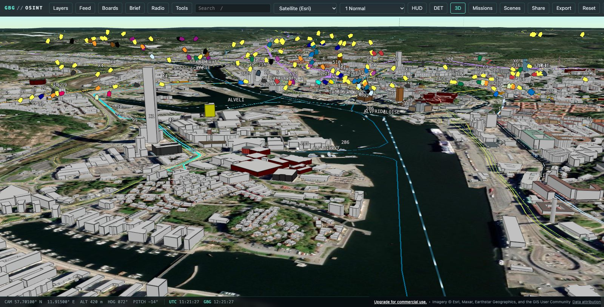

| 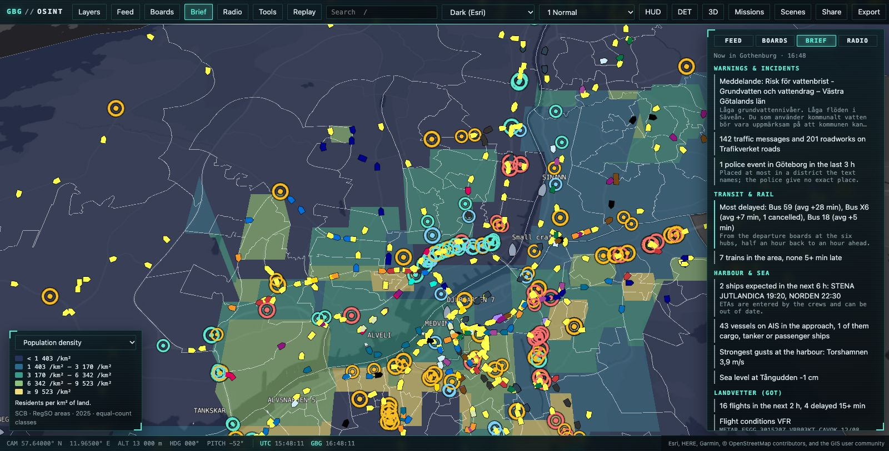 | 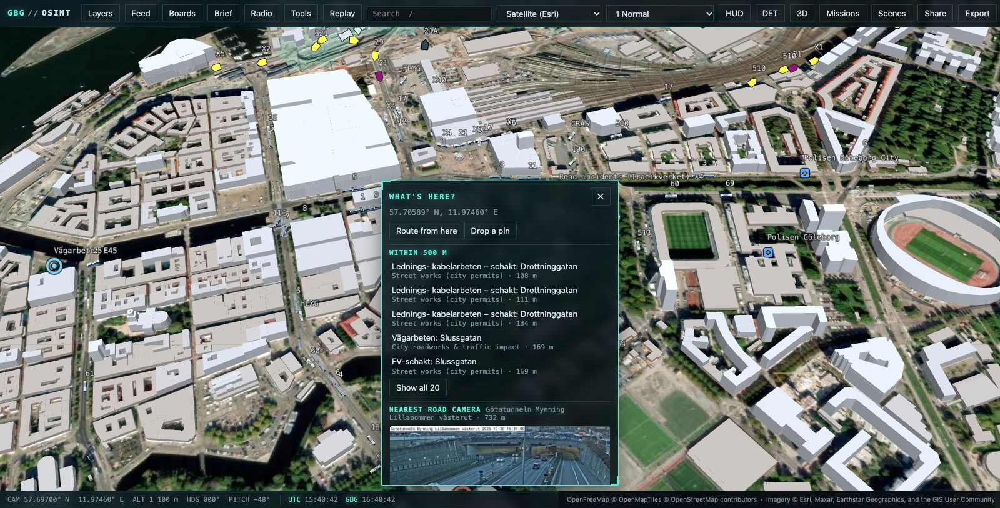 | 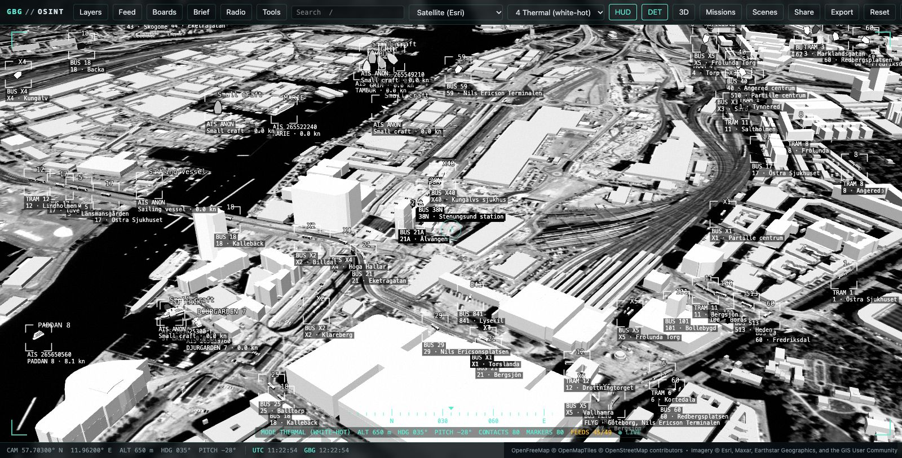 |
| :---------------------------------------------------------------------------------------------------: | :---------------------------------------------------------------------------------------------: | :------------------------------------------------------------------------: |
|                         District statistics and the "Now in Gothenburg" brief                         |                             "What's here?" for any spot on the map                              |               Optics styles with the HUD and detection boxes               |

**Contents:** [What's on the map](#whats-on-the-map) · [What you can find out](#what-you-can-find-out) · [Quick start](#quick-start) · [API keys](#api-keys-optional) · [Using it](#using-it) · [Configuration](#configuration) · [Data, caching and history](#data-caching-and-history) · [Troubleshooting](#troubleshooting) · [Responsible use](#responsible-use) · [Development](#development)

## What's on the map

The server runs 52 connectors, one per data source. Most need no key; the last column says which themes do.

| Theme            | What you see                                                                                                                                                                                | From                                                                           | Key                                         |
| ---------------- | ------------------------------------------------------------------------------------------------------------------------------------------------------------------------------------------- | ------------------------------------------------------------------------------ | ------------------------------------------- |
| Public transport | Live trams, buses and ferries, matched to their tracks and roads; departure boards for the main hubs; timetable routes in line colours and every stop                                       | Västtrafik, Trafiklab (GTFS)                                                   | Västtrafik, Trafiklab                       |
| Rail             | Live trains with their delay, rail disruptions, the Göteborg C board                                                                                                                        | Trafikverket                                                                   | Trafikverket                                |
| Roads            | Incidents and roadworks, road cameras, measured travel times, illustrative traffic, road weather stations, road ferries (Hönö, Björkö, …), city roadworks and street-work permits           | Trafikverket, Göteborgs Stad                                                   | Trafikverket, Göteborgs Stad                |
| Sea              | Ships (AIS) and their tracks, ships expected at Gothenburg with their ETA, harbour wind, current and water level, sea level, Göta älv levels, a wave and sea-temperature forecast off Vinga | aisstream.io, Sjöfartsverket ViVa, SMHI, Göteborgs Stad, MET Norway            | aisstream.io, Göteborgs Stad (river levels) |
| Air and space    | Aircraft and their routes, Landvetter departures and arrivals, airport weather (METAR/TAF), GNSS quality, satellites above the horizon                                                      | adsb.fi, adsbdb, Swedavia, aviationweather.gov, CelesTrak                      | Swedavia (flight boards)                    |
| Weather          | Observations, 12-hour forecast, warnings, precipitation radar, 2-hour rain nowcast, animated wind, yesterday's satellite image                                                              | SMHI, MET Norway, Open-Meteo, NASA GIBS                                        | –                                           |
| Environment      | Air quality (city stations and citizen sensors), modelled road traffic noise, pollen forecast, bathing-water quality, rivers and streams                                                    | Göteborgs Stad, Sensor.Community, Pollenrapporten, HaV, OpenStreetMap          | –                                           |
| Events and news  | Police events, crisis alerts, local news (SVT Väst, Göteborgs-Posten), public social posts                                                                                                  | Polisen, Krisinformation, SVT, GP, Bluesky, Mastodon                           | –                                           |
| City             | 3D buildings; district statistics (population, age, education, income); emergency services and points of interest; street-level photos; nearby Wikipedia articles; address search; routing  | OpenFreeMap, SCB, OpenStreetMap, Panoramax, KartaView, Wikipedia, Photon, OSRM | –                                           |
| Energy and more  | Electricity price (SE3), Sweden's energy mix, Styr & Ställ bike stations, live radio                                                                                                        | elprisetjustnu.se, Energy-Charts, nextbike, radio-browser.info                 | –                                           |
| Maps and 3D      | Esri satellite and dark maps, OpenStreetMap, CARTO maps; 3D terrain and buildings                                                                                                           | Esri, OpenStreetMap, CARTO, Cesium ion                                         | CARTO, Cesium ion                           |

The status button at the right of the top bar lists every source with its state, last update and licence, and the app credits each source on screen.

## What you can find out

A few things to try. Every picture is a real moment from the running app.

### How public transport is moving

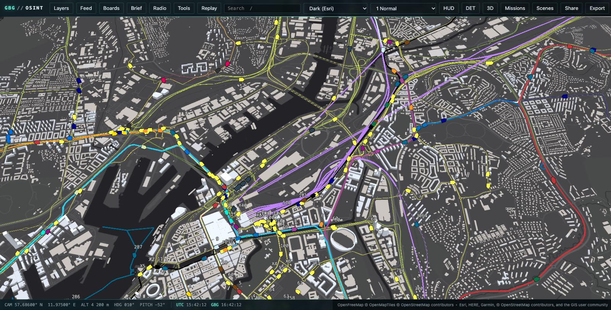

Every tram, bus and ferry with its line number, on the routes it follows. Trams are matched to their tracks and buses to the streets, so they move along the network instead of across blocks. Press `N` for the brief: its delay index lists the lines and hubs running latest right now (a departure counts as late from 3 minutes).

_Try it:_ turn on _Layers › Infrastructure › Public transport routes_ and pick the _Dark (Esri)_ map.

### What's arriving at the port

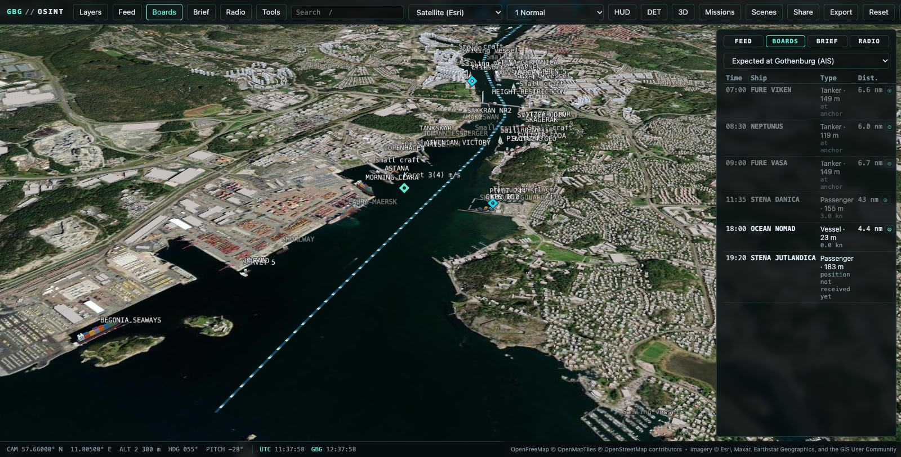

Ships report their destination and ETA over AIS. _Boards › Expected at Gothenburg (AIS)_ turns that into an arrivals board: tankers waiting at anchor, the Stena ferries and how far out they are. Click a ship for its size, speed and status, and press `T` to follow it. The ViVa stations show wind, current and water level at the harbour entrance.

_Try it:_ the _Harbour watch_ mission (`M`).

### Where that plane is going

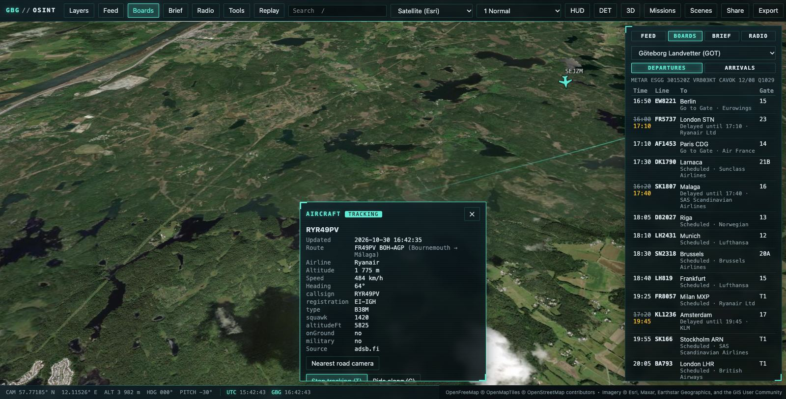

Aircraft positions come from volunteer ADS-B receivers. Select one to see where it flies from and to (here Luleå → Gothenburg, 750 m up on approach) and the path it has taken; `C` puts you in the cockpit. The Landvetter board shows gates, delays (KLM to Amsterdam, now 14:30) and the current METAR.

_Try it:_ the _Approach GOT_ mission, or the _Final approach, Landvetter_ tour (`S`).

### How long it takes across town

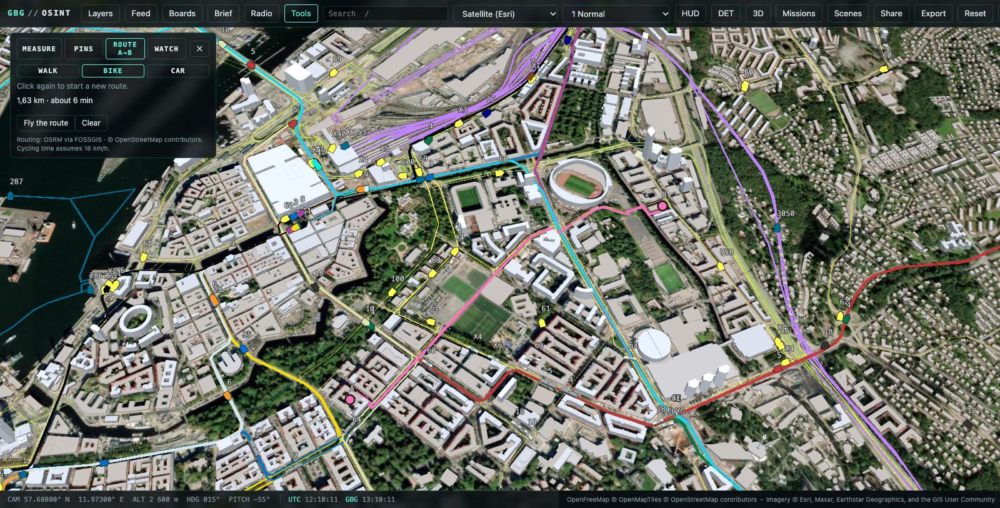

Press `G`, choose _Route A→B_ and click two points to get the distance and time on foot, by bike or by car. _Fly the route_ then follows it with the camera.

### Get told when something happens in an area

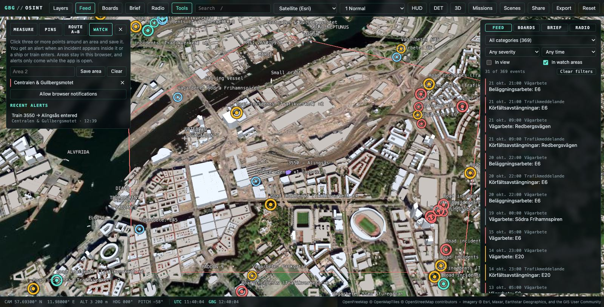

Draw a watch area (`G` › _Watch_) and the app alerts you when a new incident appears inside it or a ship or train enters, also as a browser notification if you allow it. Here train 3550 to Alingsås has just entered. The feed's _In watch areas_ filter narrows 369 events down to the 31 inside the area.

### Conditions now, and over the last day

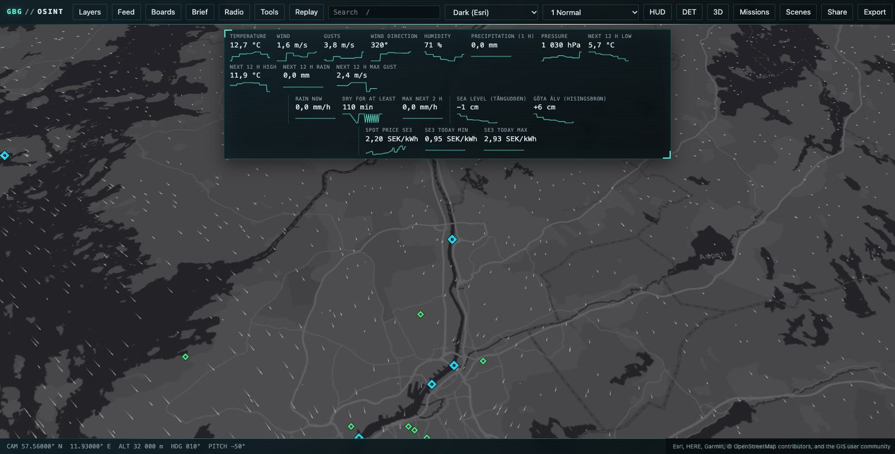

Hover the metrics strip for 24-hour sparklines: temperature, wind, pressure, sea level, the river at Hisingsbron, the electricity price and more. The animated wind layer shows how the air moves across the archipelago.

_Try it:_ the _Storm watch_ mission.

### What's overhead

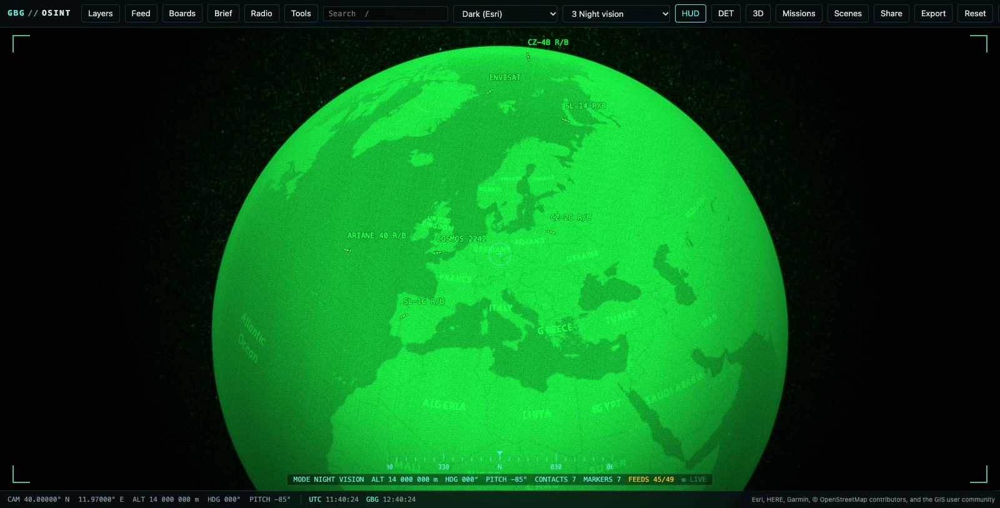

Satellites and rocket bodies currently above Gothenburg's horizon, from CelesTrak orbits. Zoom out to see them over the globe.

_Try it:_ the _Sky watch_ mission, in night vision with the HUD.

## Quick start

You need [Node.js 24+](https://nodejs.org/), Git and a browser with WebGL 2 (any recent Chrome, Edge, Firefox or Safari).

```sh
git clone https://github.com/vivekvivian1294/gbg-osint.git
cd gbg-osint
npm install
npm start
```

Then open **http://localhost:8787**. `npm start` builds the app and runs it as one process. Stop it with `Ctrl+C`.

On the first start:

- The _Missions_ dialog suggests some ready-made views. `?` shows the keyboard shortcuts at any time.
- Keyless layers fill within a minute. Slow-changing data (the street network, buildings, district boundaries and, with a key, the public transport timetable) is downloaded once and then cached, so those layers can take a few minutes the first time.
- Sparklines and the brief's unusual readings need history: the server takes its first sample after two minutes, then one every five.

To update, run `git pull`, `npm install` and `npm start` again.

### Or with Docker

```sh
docker compose up --build
```

Then open **http://localhost:8787**. Downloaded data (street network, buildings, districts) is kept in a Docker volume between runs.

## API keys (optional)

Everything keyless works out of the box. Keys unlock more layers. Copy `.env.example` to `.env` and fill in the ones you have:

| Variable                                           | Unlocks                                                                                                                                    | Register at                                                   |
| -------------------------------------------------- | ------------------------------------------------------------------------------------------------------------------------------------------ | ------------------------------------------------------------- |
| `VASTTRAFIK_CLIENT_ID`, `VASTTRAFIK_CLIENT_SECRET` | Live trams, buses and ferries; departure boards                                                                                            | [developer.vasttrafik.se](https://developer.vasttrafik.se/)   |
| `TRAFIKVERKET_API_KEY`                             | Road incidents, cameras, road weather, traffic flow and travel times; live trains, rail disruptions and the Göteborg C board; road ferries | [data.trafikverket.se](https://data.trafikverket.se/)         |
| `GBG_STAD_APP_ID`                                  | City traffic impact, street-work permits and water levels                                                                                  | [goteborg.se/psidata](https://goteborg.se/psidata)            |
| `AISSTREAM_API_KEY`                                | Ships (AIS)                                                                                                                                | [aisstream.io](https://aisstream.io/)                         |
| `SWEDAVIA_FLIGHTINFO_KEY`                          | Landvetter departures and arrivals                                                                                                         | [apideveloper.swedavia.se](https://apideveloper.swedavia.se/) |
| `CARTO_API_KEY`                                    | Dark Matter and Voyager basemaps                                                                                                           | [carto.com](https://carto.com/)                               |
| `TRAFIKLAB_GTFS_REGIONAL_KEY`                      | Public transport routes and stops (GTFS Regional Static)                                                                                   | [trafiklab.se](https://www.trafiklab.se/)                     |
| `CESIUM_ION_ACCESS_TOKEN`                          | 3D terrain and buildings (the `3D` button)                                                                                                 | [ion.cesium.com](https://ion.cesium.com/)                     |

Keys stay on your machine: the server uses them, and only the CARTO key and the Cesium ion token are sent to your browser (give the ion token the `assets:read` scope only). Each layer says which key it needs instead of failing silently. Restart the server after you change `.env`.

All of these have a free tier. Some notes:

- **Västtrafik:** create an application in the developer portal and use its client ID and secret. The app uses the Planera Resa v4 API.
- **Trafiklab:** the GTFS Regional _static_ key has a small monthly quota. The app downloads the timetable (about 100 MB) at most once a week and keeps it in the cache.
- **Cesium ion:** the free Community plan is for non-commercial use.

## Using it

### The screen

- **Top bar:** _Layers_ turns sources on and off. _Feed_, _Boards_, _Brief_ and _Radio_ open the side panel, _Tools_ the map tools and _Replay_ the timeline. Then come the search box, the base map, the optics style, _HUD_, _DET_ (detection boxes), _3D_ (only with a Cesium ion token), _Missions_, _Scenes_, _Share_, _Export_, _Reset_ and `?`. The status button on the far right shows the live connection; click it for the state of every source.
- **Metrics strip:** current conditions such as weather, sea and river levels and the electricity price. Hover it for 24-hour sparklines.
- **Bottom bar:** camera position, heading and pitch, UTC and Gothenburg time, and the credits for what is on screen.

### Keyboard shortcuts

| Key            | Action                                                                          |
| -------------- | ------------------------------------------------------------------------------- |
| `1`–`6`        | Optics: Normal, CRT, Night vision, Thermal (white-hot), Thermal (ironbow), Noir |
| `H`            | HUD on or off                                                                   |
| `D`, `Shift+D` | Detection boxes on or off; cycle how many objects get a box                     |
| `T`            | Track the selected object, or stop tracking                                     |
| `C`            | Ride along with the tracked vehicle, ship or aircraft                           |
| `←` `→`        | Step through contacts while tracking                                            |
| `R`            | Back to the city view                                                           |
| `/`            | Search                                                                          |
| `B`            | Departure boards                                                                |
| `N`            | Now in Gothenburg (situation brief)                                             |
| `P`            | Replay: scrub back through the last 7 days                                      |
| `W`            | What's here? at the centre of the view                                          |
| `M`            | Missions                                                                        |
| `S`            | Scene director (camera tours)                                                   |
| `G`            | Map tools: measure, pins, route A→B, watch areas                                |
| `E`            | Export the selection or view, or a screenshot                                   |
| `Esc`          | Leave the tool, stop tracking and tours, clear the selection                    |
| `?`            | Keyboard shortcuts                                                              |

### Layers

The _Layers_ panel groups sources into _Movement_, _Departure boards_, _Cameras_, _Infrastructure_, _Events_, _Environment_ and _Context_, and a useful set is on by default. A layer whose key is missing says _Needs key_, and one whose source is having trouble says so too; the server keeps retrying. Some layers carry a note (as a tooltip) on how to read them, for example that citizen air sensors are indicative only.

### Search

`/` searches places, live objects (a tram line, a ship, a flight), coordinates and street addresses. Addresses are looked up in OpenStreetMap via Photon only when you ask; picking one flies there and opens _What's here?_.

### Selecting, tracking and riding along

Click any vehicle, ship, aircraft, camera, event or sensor for a card with its details. `T` keeps the camera on it, `←` and `→` step to the next contact, and `C` rides along from the cab, bridge or cockpit. Ships, aircraft and trains show where they have been in the last 24 hours, sensor cards show 24-hour sparklines, and cards can show the nearest road camera.

### What's here?

Right-click the map (long-press on touch, or `W` for the centre of the view) for a report on that spot: the district and its statistics, incidents nearby, the nearest road camera, street-level photos and Wikipedia articles.

### Feed, boards and brief

- **Feed:** live events (police, crisis, roads, rail, news, social and more), filtered by category, severity, time, what's in view or what's inside a watch area.
- **Boards (`B`):** departures for the tram, bus and ferry hubs, Göteborg C, Landvetter and the road ferries, plus the ships expected at Gothenburg.
- **Brief (`N`):** "Now in Gothenburg": unusual readings, new serious road incidents and the transit delay index.

### Replay

`P` (or _Replay_) opens a timeline over the last 7 days. Scrub or play it back at 1 minute, 10 minutes or an hour per second to see events, readings, ships, aircraft and trains as they were. Trams, buses, boards and other live-only layers are empty while replaying, and _Live_ (or `P` again) returns to now. The link keeps the replayed moment.

### Tools

`G` opens the map tools. While one is active, clicks on the map place points.

- **Measure** distances, and drop **pins** that are kept in your browser.
- **Route A→B** on foot, by bike or by car, with distance and time. _Fly the route_ follows it with the camera.
- **Watch** areas alert you while the app is open when an incident appears inside one or a ship or train enters, optionally as browser notifications.

### Missions, tours and optics

- **Missions (`M`)** set up a view in one click: _City pulse_, _Sky watch_, _Approach GOT_, _Storm watch_ and _Harbour watch_.
- **Scenes (`S`)** play camera tours (_Göta älv from the sea_, _Inner city orbit_, _Port of Gothenburg_, _Final approach, Landvetter_), record your own, and save or open them as files to share.
- **Optics (`1`–`6`)** restyle the picture as CRT, night vision, thermal or noir, with an optional HUD and detection boxes. They are visual effects, not sensor data.
- **3D** switches to Cesium World Terrain and Cesium OSM Buildings (needs a Cesium ion token). Without it, buildings come from OpenFreeMap on a flat map.

### Export and share

- **Export (`E`):** the selection or everything in view as GeoJSON or CSV, with the source of each item, or a PNG screenshot with the time and credits in a footer.
- **Share** copies a link to the current view. The URL keeps the camera, map, layers, optics and tracked object, so the link reopens the same view on any copy of the tool.

<details>
<summary>URL parameters</summary>

For example `http://localhost:8787/#cam=11.97,57.70,4000,0,-60&map=dark&layers=transit,ships`.

| Parameter               | Meaning                                                                    |
| ----------------------- | -------------------------------------------------------------------------- |
| `cam`                   | Camera: longitude, latitude, height (m), heading (°), pitch (°)            |
| `map`                   | Base map: `imagery`, `dark`, `osm`, `carto-dark`, `carto-voyager`          |
| `layers`                | Layer ids, comma-separated (see `apps/web/src/layers/registry.ts`)         |
| `style`                 | Optics: `normal`, `crt`, `nvg`, `flir`, `ironbow`, `noir`                  |
| `hud`, `det`, `terrain` | `1` turns on the HUD, detection boxes or 3D terrain                        |
| `track`                 | `<layer>:<id>` of the object to follow; add `ride=1` to ride along with it |
| `t`                     | A moment to replay, in milliseconds since 1970 (UTC)                       |

</details>

## Configuration

Settings go in `.env` with the keys (see `.env.example`). All are optional.

| Variable                    | Default                            | What it does                                                   |
| --------------------------- | ---------------------------------- | -------------------------------------------------------------- |
| `HOST`                      | `127.0.0.1`                        | Address to listen on. Keep it local.                           |
| `PORT`                      | `8787`                             | Port for the app                                               |
| `CACHE_DIR`                 | `<OS temp folder>/gbg-osint-cache` | Where downloaded data and history are kept                     |
| `UPSTREAM_USER_AGENT`       | `gbg-osint-dashboard/0.1`          | Sent to the data sources; add your e-mail or repo URL          |
| `LOG_LEVEL`                 | `info`                             | `fatal`, `error`, `warn`, `info`, `debug`, `trace` or `silent` |
| `RATE_LIMIT_PER_MINUTE`     | `120`                              | API requests per minute per client                             |
| `WS_MAX_CONNECTIONS_PER_IP` | `10`                               | Live connections per client (one per open tab)                 |
| `TRUST_PROXY`               | empty                              | Only behind a reverse proxy: addresses to trust for client IPs |

## Data, caching and history

- The server polls each source on its own schedule, within the provider's limits, and pushes changes to your browser over a WebSocket. On-demand data (radar, buildings, street photos, routes, flight routes, Wikipedia, addresses and satellite images) is only fetched when you look at it.
- Slow-changing data is cached on disk in `CACHE_DIR`: the street and rail network used to match vehicles to the map, buildings, district boundaries and statistics, station names and the timetable. Your OS may clear its temp folder, so point `CACHE_DIR` at a permanent folder to avoid downloading it all again. Docker keeps it in the `cache` volume.
- History covers the last 7 days: readings, delays and event counts in 5-minute steps, the tracks of ships, aircraft and trains, and when each event and object was present. It lives in `CACHE_DIR/history.db` (SQLite, built into Node), so it survives restarts.
- Pins, watch areas and tours live in your browser's local storage.
- To start over, stop the server and delete the cache folder.

## Troubleshooting

| Problem                              | What to do                                                                                                                                          |
| ------------------------------------ | --------------------------------------------------------------------------------------------------------------------------------------------------- |
| A layer says _Needs key_             | Add the key to `.env` (see [API keys](#api-keys-optional)) and restart the server.                                                                  |
| A layer stays empty                  | Click the status button at the right of the top bar for each source's state. Public APIs have outages and rate limits, and the server retries them. |
| The globe is black or doesn't appear | The app needs WebGL 2. Turn on hardware acceleration in your browser or try another browser.                                                        |
| `EADDRINUSE` on start                | Something else uses port 8787. Stop it, or set another `PORT` in `.env`.                                                                            |
| Sparklines are empty                 | History fills while the server runs; give it a few minutes.                                                                                         |
| There's no _3D_ button               | Set `CESIUM_ION_ACCESS_TOKEN` and restart.                                                                                                          |
| `npm install` or `npm start` fails   | Check that `node --version` is 24 or newer.                                                                                                         |

## Responsible use

- **No people tracking.** The tool shows vehicles, events, infrastructure and systems. It has no person search, no face recognition and no profiling. Camera and street-level images are only displayed.
- **Estimates are labelled.** Vehicle motion between updates, camera viewsheds and approximate event locations are modelled, and the app marks them as such. Police events are only located to the municipality.
- **Respect the sources.** Every source is credited in the app. Their terms of use and rate limits apply to you when you run the tool; please don't remove the throttling or point heavy automated use at community services (OSRM, Photon, OpenFreeMap). Setting `UPSTREAM_USER_AGENT` to include your e-mail is good practice.
- **Keep it local.** The server listens on `127.0.0.1` only. Don't expose it to the internet.

## Development

```sh
npm run dev        # web on http://localhost:5173 (hot reload), API on :8787
npm test           # unit tests (vitest)
npm run typecheck && npm run lint && npm run format:check
```

- `apps/server`: Fastify server, scheduler and one connector per source (`src/connectors/`). It serves the built web app too.
- `apps/web`: React + CesiumJS app (`src/engine/` for the 3D engine, `src/layers/` for the layer registry).
- `packages/shared`: zod schemas for the normalized model (entities, events, metrics and more).

[PLAN.md](PLAN.md) has the architecture, the data source catalogue and the roadmap. [CONTRIBUTING.md](CONTRIBUTING.md) explains how to add a data source.

## Licence

The code is MIT licensed (see [LICENSE](LICENSE)). The data belongs to its providers and is shown under their own terms and licences, which the app lists with each source.
